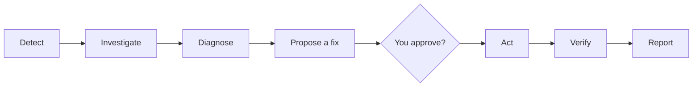

# On-Call Agent

An AI on-call engineer for the [OpenTelemetry Demo](https://github.com/open-telemetry/opentelemetry-demo)
online shop. When something breaks, it finds out what and why from the shop's telemetry,
proposes a fix, applies it only after you approve, checks that the shop recovered, and
writes an incident report.

It runs entirely on your own machine, with a local language model. No cloud AI service or API key is needed.

## How it works



1. Detect. Notices when a service's errors, latency or traffic jump away from normal, or
   when a container stops or is starved of CPU.
2. Investigate. The model looks at metrics, traces, logs and container health, one tool at a time.
3. Diagnose. Names the faulty component and the cause, citing the evidence it found.
4. Propose a fix. Picks one safe action, for example restarting a stopped container.
5. Approve. Nothing changes until you approve the action.
6. Act. The action is carried out through the Action API, the only way the agent can change anything.
7. Verify. Waits until the shop is healthy again. If it does not recover, the action is undone.
8. Report. Writes what happened, why, and how to prevent it.

If the agent is not sure, or you reject the fix, it stops and hands over to you with everything it found.

More detail: [docs/architecture.md](docs/architecture.md).

## Requirements

- Windows 11 with WSL2 Ubuntu, or Linux
- Docker Engine with Compose, inside WSL (Docker Desktop is not needed)
- [Ollama](https://ollama.com) with the `qwen3:4b` model. A 4 GB NVIDIA GPU is enough.
- Python 3.11 or newer
- About 14 GB of free disk and 10 GB of RAM for WSL

## Installation

1. WSL settings (Windows only). Create `C:\Users\<you>\.wslconfig` with the content below,
then run `wsl --shutdown` in PowerShell:

```ini
[wsl2]
memory=10GB
swap=0
processors=6
```

2. Docker (inside Ubuntu). Reopen Ubuntu after the last command.

```bash
curl -fsSL https://get.docker.com | sudo sh
sudo usermod -aG docker $USER
```

3. The OpenTelemetry Demo (release 3.1.0) and its images. `demo.bat` does this for you the
first time it runs (step 7). To do it ahead of time instead, run from the project folder:

```bash
git clone --branch 3.1.0 --depth 1 https://github.com/open-telemetry/opentelemetry-demo.git ~/opentelemetry-demo
bash scripts/demo.sh pull
```

4. Helper image. Only needed for the network-latency practice incident.

```bash
docker pull nicolaka/netshoot:v0.13
```

5. The local model

```bash
sudo apt-get update && sudo apt-get install -y zstd python3.12-venv
curl -fsSL https://ollama.com/install.sh | sh
ollama pull qwen3:4b
```

6. Python environment

```bash
python3 -m venv ~/.venvs/oncall
~/.venvs/oncall/bin/pip install -e ".[dev]"
cp .env.example .env
```

7. First start. Double-click `demo.bat` and wait until it shows `22/22` containers ready.
The first time, it downloads about 10 GB. Then, in WSL:

```bash
~/.venvs/oncall/bin/oncall check        # every backend should say ok
```

Wait about 5 minutes for the shop's traffic to settle, then save what "healthy" looks like:

```bash
~/.venvs/oncall/bin/oncall baseline
```

## Starting and stopping

Two buttons in the project folder. Each one keeps its window open while it runs. To stop it,
press Ctrl+C or close the window.

| Button | Starts | Linux / WSL shell |
|---|---|---|
| `demo.bat` | WSL and the demo shop with its telemetry (22 containers). Waits until they are healthy, then shows the links. | `scripts/demo.sh run` |
| `start.bat` | The console and the Action API, and opens http://localhost:8800 | `scripts/serve.sh` |

Start `demo.bat` first. Closing its window stops the containers, and they stay stopped until
you start them again.

## Using the console

| Area | What it does |
|---|---|
| Respond | Investigate checks for an incident now. You can also type an alert yourself. Cancel investigation stops a running one. |
| Auto-detect | Checks for incidents every 20 seconds and starts an investigation on its own |
| Dry run | When on (the default), approved actions are only described, never carried out |
| Kill switch | Blocks every action until you release it |
| Practice incident | Breaks something on purpose (for example cache-down) so you can watch the agent work. Reset all undoes it. |
| Services | Live requests/s, error % and latency per service. Abnormal ones are shown in red. |
| Investigation | Every step the agent takes, live |
| Diagnosis | The faulty component, the cause, the confidence and the evidence |
| Approval needed | Enter your name, then Approve or Reject the proposed action |
| Action log | Every action request and its result. Clear starts a fresh log and keeps the old one in `runs/`. |

A quick tour:
1. Turn Dry run off.
2. Inject cache-down and press Investigate.
3. When asked, approve the restart, and watch the agent confirm that the shop recovered.

## Command line

```bash
oncall check                                   # are Prometheus, Jaeger, OpenSearch and the model reachable?
oncall detect                                  # check for an incident once
oncall investigate "checkout error rate high"  # diagnose only, change nothing
oncall respond "checkout error rate high"      # full loop, approval asked in the terminal
oncall respond "..." --dry-run                 # same, but actions are only described
oncall watch                                   # keep checking and respond to incidents
oncall baseline                                # save the current state as healthy

faultctl list                                  # practice incidents
faultctl inject cache-down                     # break something on purpose
faultctl reset                                 # undo every practice incident
python -m evaluation                           # run every practice incident and score the agent
```

The commands live in `~/.venvs/oncall/bin/`. Run `source ~/.venvs/oncall/bin/activate` first
to use them by name.

## Incident reports

Each incident is saved as `reports/<id>.md` (readable) and `reports/<id>.json`. The JSON follows
[schemas/incident_report.schema.json](schemas/incident_report.schema.json). A report has:

- the alert, the diagnosis and its evidence
- the action, who approved it and the result
- the recovery checks and a timeline
- advice on preventing a repeat

## Configuration

Settings are in `.env`. The defaults work with the local demo.

| Setting | Default | Meaning |
|---|---|---|
| `DRY_RUN` | `true` | Describe actions instead of carrying them out |
| `OLLAMA_MODEL` | `qwen3:4b` | Any Ollama model with tool calling; a larger one may diagnose better |
| `OLLAMA_NUM_GPU` | `99` | Model layers on the GPU; lower it if the model fails to load |
| `OLLAMA_THINK` | `false` | Reasoning mode: slower, rarely better |
| `MAX_STEPS` | `12` | Tool calls per investigation |
| `MIN_CONFIDENCE` | `0.6` | Below this, the agent hands over instead of acting |
| `PROMETHEUS_URL`, `JAEGER_URL`, `OPENSEARCH_URL` | local demo | Where the telemetry is. OpenSearch is found automatically. |

## Safety

- You decide. The agent only proposes. Every real action needs a named approver.
- Small set of actions. The Action API allows only four actions: restart a service,
  lift a service's CPU limit, switch a feature flag, or slow down the load generator. It never
  touches the telemetry stack or the feature-flag service itself.
- Dry run by default, a kill switch, and Cancel at any point.
- Undo on failure. If the shop does not recover, the action is rolled back.
- Everything is logged. Every action request is logged, including refused ones.
- Evidence, not guesses. Every diagnosis must cite real tool results, and at least two
  sources must agree. Otherwise the agent hands over to you.
- No flag peeking. The agent works out faults from telemetry only. It never reads the
  shop's feature-flag settings.

## Good to know

- Lean demo. `scripts/demo.sh` runs the 22 services the agent needs, so the shop fits in
  10 GB next to the model. Kafka, accounting, fraud detection, Grafana and the flag UI are left out.
- Memory override. `compose.local.yaml` gives six demo services more memory, so they run
  reliably on a laptop. It does not change any demo code or how incidents behave.
- When the agent hands over. Faults inside a running application (not a stopped or
  crashed container) are diagnosed and reported, but you fix them yourself.
- Small model. A small local model can misjudge an incident. When the evidence is weak it
  hands over instead of acting.
- Cancel delay. Cancel takes effect after the model's current step, which can take up to about 20 seconds.

## Project layout

```
src/oncall/        the agent: detector, investigation, tools, rules, reports
src/console/       the web console
src/actionapi/     the Action API
src/faultctl/      practice incidents
src/evaluation/    scores the agent on practice incidents
scripts/           demo.sh (start/stop the demo), serve.sh (start/stop the console)
demo.bat           one-click start/stop of the demo containers (Windows)
start.bat          one-click start/stop of the console (Windows)
docs/              architecture
tests/             unit tests: python -m pytest
```
