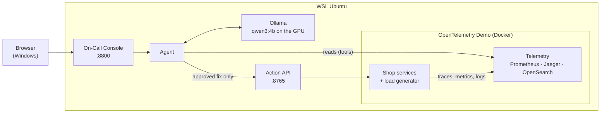
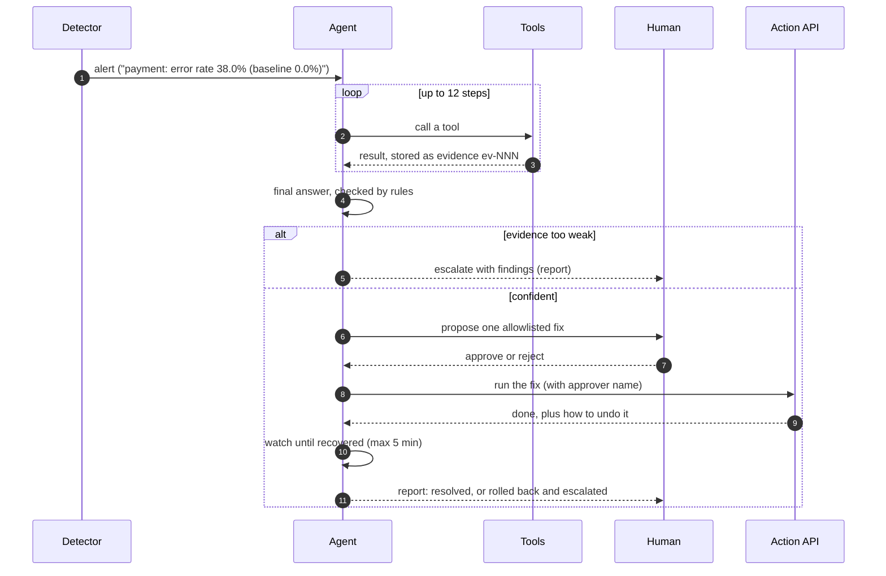
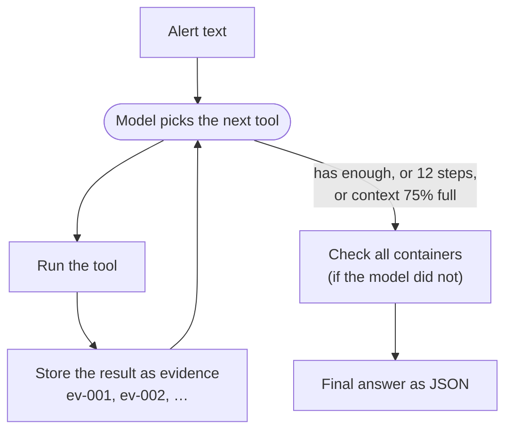
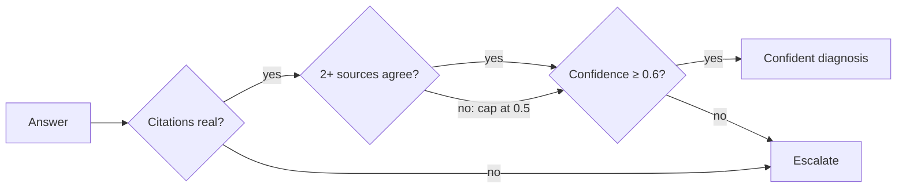

# Architecture

The agent watches the OpenTelemetry Demo, works out what broke from its telemetry, and proposes
a fix. A human approves the fix, and the agent then checks that it worked. This page explains
each part in the order an incident flows through them.

- [What runs where](#what-runs-where)
- [One incident, start to finish](#one-incident-start-to-finish)
- [1. Detect](#1-detect)
- [2. Investigate: the tools](#2-investigate-the-tools)
- [3. Diagnose: model answer, then rules](#3-diagnose-model-answer-then-rules)
- [4. Propose: remedy rules](#4-propose-remedy-rules)
- [5–7. Approve, act, verify](#57-approve-act-verify)
- [8. Report](#8-report)
- [Safety controls](#safety-controls)
- [Practice incidents and evaluation](#practice-incidents-and-evaluation)
- [Code map](#code-map)

## What runs where

Everything runs on one laptop. Windows only shows the browser; the rest runs inside WSL Ubuntu.



| Part | What it is | Who made it |
|---|---|---|
| OpenTelemetry Demo 3.1.0 | A telescope shop made of microservices, plus a load generator that creates constant traffic | Open source, run in a lean setup (`scripts/demo.sh`) |
| Prometheus, Jaeger, OpenSearch | Where the demo's metrics, traces and logs are stored | Ship with the demo |
| Ollama + `qwen3:4b` | The local language model. Free, offline, and fits a 4 GB GPU | Open source |
| Agent (`src/oncall`) | Detector, investigation loop, rules, recovery check, reports | Us |
| Action API (`src/actionapi`) | The only component allowed to change the system | Us |
| On-Call Console (`src/console`) | Web page for the demo: live feed, approve/reject, kill switch | Us |
| faultctl (`src/faultctl`) | Injects and resets practice incidents | Us |

The agent can only *read* the telemetry. Changes go through the Action API, and the Action API
needs a named approver.

## One incident, start to finish



## 1. Detect

`detector.py` saves a **baseline** of every service while the demo is healthy (`oncall baseline`).
It then compares the last 3 minutes with that baseline. The window is 3 minutes because
Prometheus scrapes once a minute.

| Alert | Fires when |
|---|---|
| Errors | error rate ≥ 5 %, at least 5 points and 2× above baseline, and at least 4 failed requests |
| Latency | p95 ≥ 500 ms and at least 3× the baseline |
| Traffic surge | requests/s at least 2× the baseline and at least 5/s more |
| Silent | a service that had ≥ 0.3 requests/s at baseline has stopped completely |
| Container | a demo container is not running, was OOM-killed, or is limited to under 0.25 CPU cores |

The container alert comes from Docker, not from metrics. It catches a starved or stopped
service even when its traffic is too low to move the numbers, and it is listed first.
If half or more of the busy services go silent at once, the agent treats it as a telemetry gap,
not an incident. The load generator's own numbers are ignored, because its errors are only
symptoms. The console's **auto-detect** runs this check every 20 seconds, and `oncall watch`
does the same from the command line.

## 2. Investigate: the tools

The model chooses which tool to call next. Every tool is read-only.

| Tool | Reads from | Gives the model |
|---|---|---|
| `service_overview` | Prometheus | requests/s, error % and p95 latency per service, next to the baseline |
| `search_traces` | Jaeger | failed requests: where each failure *starts*, calls that got no answer, who calls whom, slowest operations |
| `search_logs` | OpenSearch | warning and error lines grouped into distinct messages with counts |
| `container_health` | Docker | stopped, unhealthy, restarted, OOM-killed or CPU-starved containers, and any delay rule on a container's network |
| `deployment_history` | Docker | containers started or restarted recently: what changed just before |



A few details make a small model reliable here:

- **Evidence ledger.** Every tool result gets an ID. The final answer must cite those IDs, and
  invented IDs are rejected.
- **Container sweep.** If the model never checked all containers, the agent does it
  automatically before the final answer, so a stopped database is never missed.
- **Constrained answer.** The final JSON must match a schema in which the component can only
  be a service that appeared in the evidence. The model can't invent names like "root_cause".
- **Context limit.** When the conversation fills 75% of the model's context window, the agent
  stops investigating and asks for the answer.
- **Nudge.** If the model tries to stop before covering the basics (metrics, traces, containers),
  it is reminded once.
- **No flag peeking.** The rules forbid reading feature-flag settings. Tools cannot reach flagd
  or the flag UI, flag events are removed from traces, and flagd's own spans are left out of the
  metrics. Those spans also used to look like 15-second payment delays.

## 3. Diagnose: model answer, then rules

The model's answer is checked by fixed rules, in this order. The first rule that matches
replaces the model's pick. The model's original explanation is kept in the report.

| # | If the evidence shows… | Then blame… | Why |
|---|---|---|---|
| 1 | exactly one container **not running** or **OOM-killed** | that container | a dead dependency explains its callers' errors |
| 2 | the blamed service's calls to another service got **no answer** | the service that didn't answer | the caller is only the messenger |
| 3 | traced failures **start** in a service that the blamed one depends on | where the failures start | errors travel up the call chain |
| 4 | nothing supports the model's pick, and exactly **one container** has problems | that container | it is the only concrete lead |

Then the answer is validated:



"Sources agree" means the blamed component shows a problem in at least two places: two
different tools, or one tool plus the alert itself.

## 4. Propose: remedy rules

The model diagnoses, but it never chooses the action. `remedy.py` picks one with fixed,
explainable rules:

| Diagnosis | Proposed action |
|---|---|
| The load generator floods the shop | `throttle_load_generator` to 1 user |
| The container is limited to under 0.25 CPU cores | `remove_cpu_limit` on that container |
| The container's network has a delay rule | `restart_service`: a restart rebuilds the container's network without the rule |
| The container is not running, unhealthy, restarting, OOM-killed or near its memory limit | `restart_service` on that container |
| The container is healthy, but the alert shows a traffic surge on it | `throttle_load_generator` to 1 user: the load generator is the only traffic source here |
| Anything else (container healthy, fault inside the application) | none: escalate with the findings |

Faults inside a healthy application are escalated on purpose. Fixing them would mean turning
off the feature flag that caused them, and choosing that flag would require reading flag
settings, which the rules forbid.

## 5–7. Approve, act, verify

**Approve.** The proposal goes to a human: the **Approve / Reject** card in the console, or a
`yes/no` prompt in `oncall respond`. Real actions need the approver's name.

**Act.** The agent sends the approved action to the Action API, which checks it again before
doing anything:

- the action is on the allowlist: `restart_service`, `toggle_feature_flag`,
  `throttle_load_generator`, `remove_cpu_limit`. `scale_service` exists but is always refused,
  because the demo runs on Docker Compose, not Kubernetes.
- the target is a demo container and not part of the telemetry stack or flagd (protected)
- an approver is named, unless it is a dry run
- the kill switch is not engaged

Every call is written to `runs/actions.jsonl`, refused ones included, together with how to undo it.

**Verify.** Every 20 seconds for up to 5 minutes, the agent checks two things:

1. the container is running and healthy, and
2. neither the component nor any service named in the alert is still abnormal.

If both hold, the incident is **resolved**. If not, the action is **rolled back** where
possible and the incident **escalates**. A brief metrics outage, for example under heavy CPU
load, is waited out rather than counted as a failure.

## 8. Report

Each incident is written to `reports/<id>.json`, which follows
[`schemas/incident_report.schema.json`](../schemas/incident_report.schema.json), and to a
readable `reports/<id>.md`. A report contains:

- the alert and the diagnosis, with cited evidence and confidence
- the proposed action, the approval and the result
- the recovery checks
- a timeline
- prevention advice

The final status is one of: `resolved`, `escalated`, `rejected`, `dry_run`, `cancelled`.

## Safety controls

| Control | What it does |
|---|---|
| Human approval | The agent only proposes; nothing changes without a named approver |
| Allowlist | Only the listed actions exist; the telemetry stack and flagd can never be touched |
| Dry run | On by default; the Action API only describes what it would do |
| Kill switch | Console button or `touch .killswitch`; blocks every action |
| Cancel | Stops an investigation, approval wait or recovery check; still writes a report |
| Rollback | A failed recovery undoes the action where possible and escalates |
| Audit log | Every Action API call is logged; **Clear** in the console archives the log, never deletes it |
| Escalate when unsure | Weak or uncorroborated answers go to a human instead of acting |

## Practice incidents and evaluation

`faultctl` injects 14 practice incidents and can reset each one exactly:

| Application faults (via feature flags) | Infrastructure faults |
|---|---|
| payment-failure, payment-unreachable, cart-failure, product-catalog-failure, recommendation-cache-leak, ad-high-cpu, ad-gc, homepage-flood, image-slow | service-down (checkout stopped), cache-down (Valkey stopped), db-down (Postgres stopped), cpu-starve (product-catalog limited to a sliver of CPU), network-latency (2 s delay on cart) |

`python -m evaluation` runs each practice incident in five steps:

1. wait until the system is calm
2. inject the incident
3. wait for the alert
4. run the investigation
5. score the answer against the expected component, using exact names only

The expected answers live only in `src/evaluation/`, which the agent never imports.

| Run | Correct | Of which confident | Escalated | Wrong |
|---|---|---|---|---|
| First run | 2 / 14 | – | 9 | 3 |
| Best full run | **12 / 14** | 8 | 1 | 1 |

The one wrong answer in the best run came from the previous incident not having fully cleared.
The harness now also waits for containers to be healthy before injecting.

The live loop was also tested end to end: diagnose, propose, approve, act, verify.

| Incident | Agent's answer | Action | Outcome |
|---|---|---|---|
| service-down, cache-down, db-down | the stopped container | `restart_service` | resolved in 1–3 minutes (cache-down also through the console) |
| network-latency | cart, confidence 1.0 | `restart_service` (rebuilds its network) | resolved |
| cpu-starve | product-catalog, confidence 1.0 | `remove_cpu_limit` | resolved |
| homepage-flood | frontend, confidence 0.95 | `throttle_load_generator` | eased: traffic back to normal, flood setting still on |
| image-slow | frontend-proxy, confidence 0.5 | none | handed over, and correctly not throttled |

In these practice runs the approval was given automatically under the name "ai assistant".
The other 8 incidents are flag-driven application bugs: the agent diagnoses and hands them over.

**Thinking mode** (`OLLAMA_THINK=true`) was compared on six hard incidents. It was slower
(~216 s vs ~130 s per investigation) and less decisive (2 vs 4 confident correct answers),
so it stays off.

## Code map

```
src/oncall/            the agent
  detector.py          baseline and alerts
  agent.py             investigation loop, final answer, rules, validation
  tools/               metrics, traces, logs, containers, deployment history (read-only)
  evidence.py          evidence ledger
  remedy.py            picks an allowlisted action or escalates
  incident.py          propose → approve → act → verify → roll back → report
  actions.py           Action API client
  schema.py            report and diagnosis models
  safety.py            allowlist and kill switch
  llm.py               Ollama client
  http.py              the only HTTP path for tools; blocks flag endpoints
src/actionapi/         Action API server, allowlist checks, call log, rollback
src/console/           On-Call Console (standard library server + one page)
src/faultctl/          practice incidents
src/ops/               docker, flag and load-generator operations (Action API and faultctl only)
src/evaluation/        evaluation harness and expected answers
```
